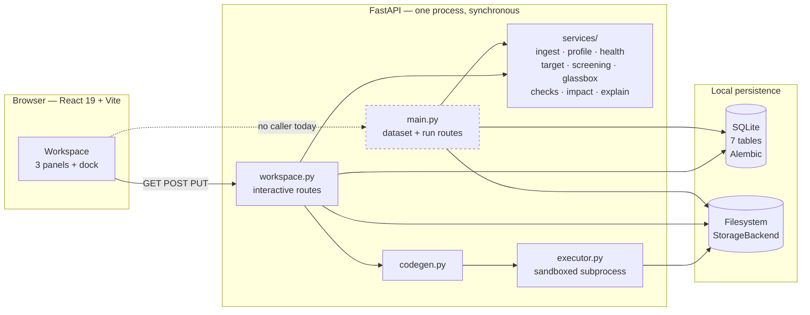
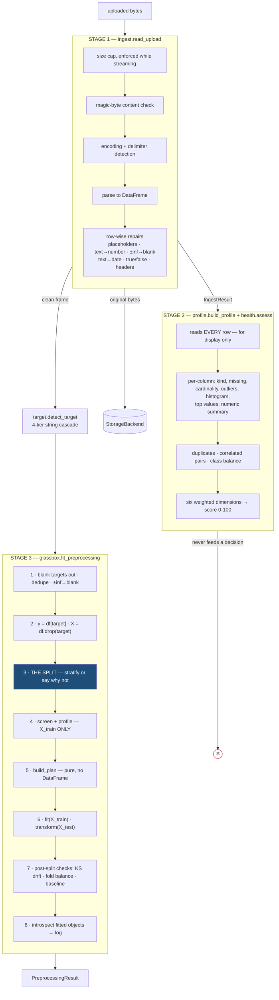
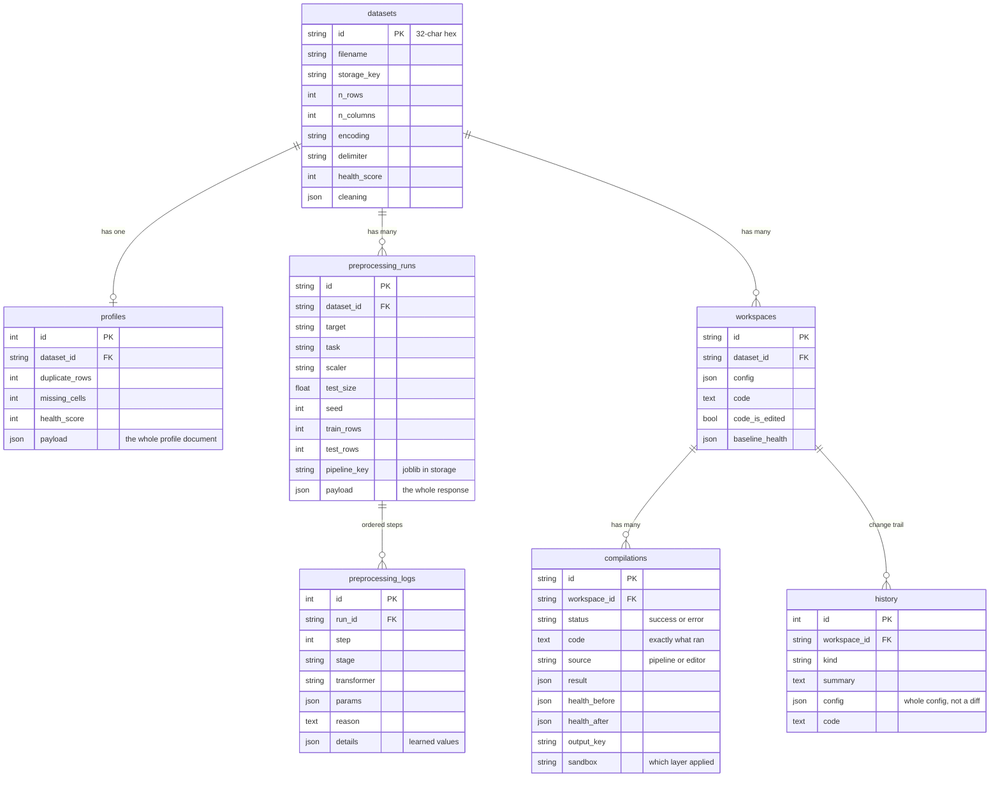
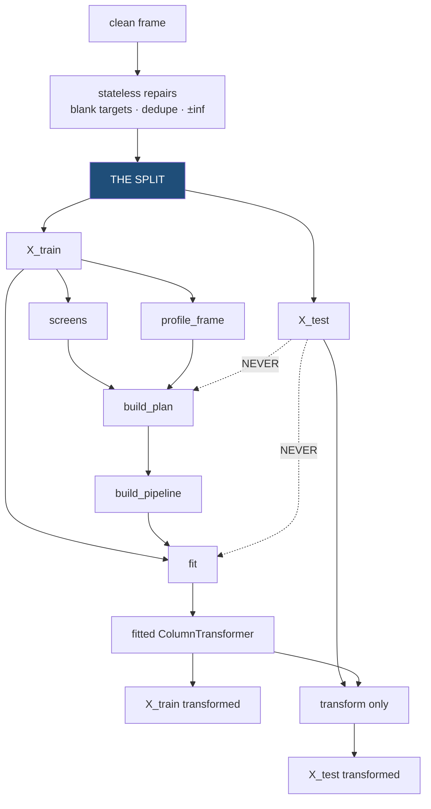
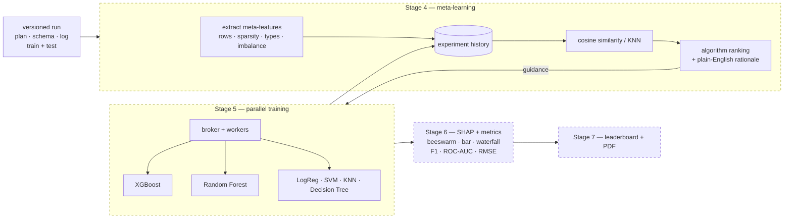
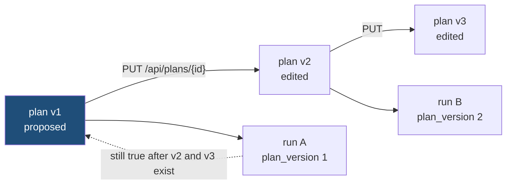

# ML-BenchX — technical design

**Version 1.0 · 30 October 2026 · describes the repository at `5a2328e` + working tree**

This document explains *how* ML-BenchX is built. It is one of three:

| Document | Answers |
|---|---|
| [PRD.md](PRD.md) | What the product must do, and what counts as done |
| **Design.md** (this) | How it is built, and why it is built that way |
| [AUDIT.md](AUDIT.md) | What is actually true today — verification evidence, defects, remediation |

Requirement identifiers (`FR-ING-001`, `NFR-004`) are defined in PRD.md §3–4 and are
referenced here rather than restated. Verification evidence and defect history live in
AUDIT.md and are referenced, not duplicated.

### How claims in this document are labelled

| Label | Meaning |
|---|---|
| **[IMPL]** | Implemented, and covered by an executed test. The test is named |
| **[PRESENT]** | Implemented, inspected, but not covered by a test that would catch a regression |
| **[PLANNED]** | Not implemented. Described as intent only |
| **[OPEN]** | A design question this repository does not answer. Recorded rather than guessed |

Nothing here describes a module, endpoint, table or integration that does not exist.
Where the design is undetermined, it appears as **[OPEN]** rather than as an assumption
stated as fact.

---

## 1. System overview

ML-BenchX is a **local, single-process, two-tier application**: a FastAPI backend and a
React single-page frontend, with SQLite for metadata and the local filesystem for bytes.
There is no queue, no broker, no cache server, no external service and no network egress
at runtime. **[IMPL]** — the executor's sandbox tests assert that the only code which
could reach the network cannot (`test_executor.py`).



The dashed edge is real and deliberate to record: **the frontend does not call the
`main.py` dataset routes.** It uploads through them and then works entirely through the
workspace routes. Both surfaces are maintained; one is used. See §4.3 and AUDIT.md §2.4.

### 1.1 The two architectural commitments

Everything else in this design follows from two decisions.

**C1 — The split precedes every measurement and every decision, not just every fit.**
The usual compromise is to profile the whole file and fit only on the training rows.
That still leaks: a category appearing exclusively in the held-out rows can push a
column over the one-hot threshold, changing the *shape* of the feature matrix the model
receives. So the split happens first and the column profile that routes every column is
computed from the training fold alone. **[IMPL]** — `test_leakage.py`,
`test_scenarios.py::test_e_rewriting_the_held_out_rows_cannot_change_the_plan`.

**C2 — The explanation is derived from fitted objects, never written beside the code.**
`introspect()` reads `statistics_`, `mean_`, `scale_`, `categories_`, `frequencies_`,
`encodings_` *after* fitting. No number in the log is computed a second time alongside
the transformation that produced it, so the log cannot drift out of sync with what ran.
A hand-maintained log drifts; a derived one cannot. **[IMPL]** — `test_glassbox.py`.

---

## 2. Implementation status against the seven-stage architecture

The product vision is seven stages. **Three are built.**

| Stage | Intent | Status | Where |
|---|---|---|---|
| **1 — Ingestion** | Upload, validate, detect encoding, infer types | **[IMPL]** | `services/ingest.py` |
| **2 — Profiling** | Health score, missing, imbalance, correlation, per-column flags | **[IMPL]** | `services/profile.py`, `services/health.py` |
| **3 — Glass-box preprocessing** | Impute, encode, scale, detect leakage, split | **[IMPL]** | `services/glassbox.py`, `codegen.py` |
| **3.5 — Plan & Run** | A reviewable per-column plan, and a durable versioned run with artifacts | **[IMPL]** | §12. The prerequisite Stage 4 was blocked on |
| **4 — Meta-learning** | Meta-features, cosine/KNN over experiment history, algorithm ranking | **[PLANNED]** | Nothing exists. §11 |
| **5 — Parallel training** | Celery workers: XGBoost, RF, LogReg, SVM, KNN, Decision Tree | **[PLANNED]** | No Celery, no broker, no worker |
| **6 — Explainability** | SHAP, beeswarm/bar/waterfall, F1 / ROC-AUC / RMSE | **[PLANNED]** | No SHAP dependency |
| **7 — Leaderboard & report** | Rankings, history, PDF | **[PLANNED]** | Nothing exists |

**No PostgreSQL.** The architecture diagram shows a PostgreSQL experiment-history
database for Stage 4. The repository uses **SQLite** (`sqlite:///backend/mlbenchx.db`),
and no PostgreSQL driver is declared in `requirements.txt`. Stage 4's store is a design
decision that has not been taken — §11.1, **[OPEN]**.

`app/plan.py` and `app/runner.py` were unreachable when this document was first
written. They no longer are: `app/services/planning.py` and `app/planning_api.py` reach
both, and they are the implementation of the plan and run resources described in §12.
Missing-indicator columns and rare-category grouping — whose thresholds `config.py` has
always carried — therefore run now rather than existing only on paper. **[IMPL]**.

---

## 3. Stage-by-stage responsibilities and data flow

### 3.1 The ordering that is the guarantee



The `✕` is load-bearing: **Stage 2's output never reaches Stage 3's decisions.** Two
profiles exist and answer different questions — `services/profile.py` describes the file
the user uploaded (every row, because telling someone "12% of `income` is blank" about
80% of their file would be a strange kind of honesty), while `glassbox.profile_frame`
runs inside the fit on the training fold because a decision informed by held-out rows is
leakage however indirect. Neither substitutes for the other. **[IMPL]** — asserted by
`test_leakage.py`.

### 3.2 Stage boundaries

| Boundary | Contract |
|---|---|
| Ingestion → Profiling | A repaired `DataFrame` plus `IngestResult.cleaning`, the story of how it got that way |
| Profiling → Preprocessing | **None.** Deliberately severed (§3.1) |
| Ingestion → Preprocessing | The clean frame and a target column name |
| Decision → Execution | `build_plan()` takes a profile and returns a dataclass. It accepts no DataFrame and fits nothing, so routing is unit-testable with no data at all |
| Execution → Explanation | `introspect()` reads fitted objects after the fact (C2) |
| Engine → Persistence | `glassbox.py` returns data structures and knows nothing about storage. `main.py` persists them |

---

## 4. Modules and packages

### 4.1 Backend — `backend/app/`

| Path | Responsibility | Status |
|---|---|---|
| `config.py` | Every threshold and seed, each with the reasoning for its value, each overridable by `MLBENCHX_<NAME>` | **[IMPL]** |
| `main.py` | FastAPI app; dataset and run routes; `UserFacingError` handler; the oversized-body middleware; CORS | **[IMPL]** |
| `workspace.py` | The 13 routes the interface drives. Every mutating route returns the **whole** workspace | **[IMPL]** |
| `schemas.py` | Pydantic request/response shapes. The API contract, and the source of `/api/docs` | **[IMPL]** |
| `db.py` | SQLAlchemy 2.x models, engine, session dependency | **[IMPL]** |
| `storage.py` | `StorageBackend` ABC + `LocalStorage`; key allow-list against traversal; writes go to a temporary file and are moved into place, so a crash mid-write cannot leave a half-written artefact | **[IMPL]** |
| `pipeline.py` | `PipelineConfig` — the eight steps as data; `STEP_ORDER`; `STEP_LABELS` | **[IMPL]** |
| `codegen.py` | `PipelineConfig` → runnable Python. The only config→code path | **[IMPL]** |
| `executor.py` | Runs user-written Python under layered isolation | **[IMPL]** (macOS; see §8.4) |
| `services/ingest.py` | Stage 1 | **[IMPL]** |
| `services/profile.py` | Stage 2 — per-column measurement for display | **[IMPL]** |
| `services/health.py` | Stage 2 — the six weighted dimensions | **[IMPL]** |
| `services/target.py` | Plain-English goal → column; task detection; class balance | **[IMPL]** |
| `services/screening.py` | Identifier and target-leakage screens, run on the training fold | **[IMPL]** |
| `services/glassbox.py` | Stage 3 engine — split, plan, fit, introspect, export | **[IMPL]** |
| `services/checks.py` | Post-split: KS drift, fold balance, sanity baseline | **[IMPL]** |
| `services/impact.py` | What turning a step off would cost, measured not guessed | **[IMPL]** |
| `services/explain.py` | Fitted objects → cards a non-technical reader can follow | **[IMPL]** |
| `app/plan.py`, `app/runner.py` | **Unreachable.** Nothing imports `runner` | **Not part of the system** (§2) |

### 4.2 Frontend — `frontend/src/`

| Path | Responsibility | Status |
|---|---|---|
| `api.ts` | The API contract mirrored by hand, and the only place the app calls HTTP | **[IMPL]** |
| `App.tsx` | Three routes: landing, upload, workspace | **[IMPL]** |
| `workspace/Workspace.tsx` | The three-panel shell and all workspace state | **[IMPL]** |
| `workspace/PipelinePanel.tsx` | Step cards, options, the impact dialog | **[IMPL]** |
| `workspace/CodePanel.tsx` | Monaco editor, compile, reset, diff | **[IMPL]** |
| `workspace/InsightsPanel.tsx` | Health, dimensions, issues, changes | **[IMPL]** |
| `workspace/BottomDock.tsx` | Data table, run log, change history | **[IMPL]** |
| `components/ui.tsx` | Buttons, toggles, dialogs, meters, the score ring | **[IMPL]** |

No frontend unit tests exist and no test runner is configured. Type-checking (`tsc -b`)
and linting (`oxlint`) run and pass — AUDIT.md §5.1. Every frontend claim here is
therefore **[PRESENT]** rather than **[IMPL]** at the component level.

### 4.3 Two API surfaces, one product

`main.py` exposes a resource-shaped API (datasets, runs, the glass-box engine).
`workspace.py` exposes the interactive workspace. They overlap: both preprocess a
dataset, by different code paths (§6.5). The interface uses only the second.

This is a known structural cost, not an accident — AUDIT.md §7 item 3. It is recorded
here because it explains an otherwise puzzling property of the codebase: **Stage 3 is
implemented twice**, and an invariant must therefore be asserted twice.

---

## 5. API contracts and schemas

Full route tables, request/response field lists and status codes are in
**[PRD.md §7](PRD.md)** and are not repeated here. This section covers only the design
decisions behind them.

### 5.1 Why every mutating workspace route returns the whole workspace

A patch response forces the client to reason about what its edit implied and reassemble
state locally. When a request fails halfway, the panels drift apart — the toggles say
one thing, the code panel another. Returning the entire workspace makes that impossible:
the client renders what it is given and holds no derived state. **[IMPL]** —
`test_workspace.py`.

The cost is payload size. For the file sizes this product accepts, that is not a real
cost; for a dataset large enough to make it one, streaming ingestion would be needed
first. **[OPEN]** if the upload cap is ever raised.

### 5.2 Error envelope

```
ingest.IngestError          ─┐
glassbox ValueError          ├─▶ main.UserFacingError ──▶ 400 {"error": "<sentence>"}
target ValueError           ─┘
missing dataset / run        ─────▶ 404 {"detail": "<sentence>"}
oversized body               ─────▶ 400, refused from headers before parsing
executor cannot start        ─────▶ 503
anything else                ─────▶ 500 — a defect, not a user error
```

Two deliberate properties. **Nothing is swallowed**: a condition that is not the user's
fault reaches the 500 handler rather than being absorbed into an empty result — a silent
degradation is the failure mode this product exists to argue against. And `{"error": …}`
is **not** the `{code, message, detail}` envelope `docs/PHASE1_SPEC.md` §7 specifies;
changing it breaks every existing client, so it is recorded as divergence rather than
fixed. AUDIT.md §5.7 O6.

### 5.3 Schema strictness, and where it stops

`app/schemas.py` states its own rule: nested documents the UI *renders* but never
*branches on* are typed as permissive dicts. Pinning every key of an explanation's
`details` block would mean editing the schema to add a sentence, and a schema's value is
in the shape callers depend on, not in every leaf.

Applied: `checks` is `dict[str, Any]`; `PipelineWarning` pins `{kind, severity, message,
suggestion}` — because the UI *would* branch on severity — and allows extras, because
each `kind` carries its own evidence. **[IMPL]** —
`test_scenarios.py::test_the_preprocess_response_carries_the_warnings_and_the_checks`.

### 5.4 Persistence schema

Seven tables, SQLAlchemy 2.x, two Alembic revisions, verified to apply from empty
(AUDIT.md §5.1).



Three design notes:

* **Every table carries `project_id` and `created_at`** via `TimestampedProjectMixin`.
  `project_id` is always `"default"` and there is no `projects` table. The column exists
  so that adding accounts later is a migration rather than a redesign. **[PRESENT]** —
  deliberate, documented, unused.
* **`history` stores the whole configuration, not a diff.** A diff is smaller, but it
  makes "restore this point" a replay of every entry since — fragile, and wrong the
  first time an entry fails to apply. A config is a few hundred bytes.
* **A failed compilation is stored like any other.** The user needs to read the error,
  compare it against the run before, and come back to it — none of which is possible if
  failures are discarded.

The `profiles.payload` and `preprocessing_runs.payload` JSON columns hold the full
response document. This trades queryability for exactness: a run reads back byte-identical
to what the user was shown. Stage 4 will need the queryable form — §11.1, **[OPEN]**.

---

## 6. Stage 1–3 detailed design

### 6.1 Stage 1 — ingestion

Ordered, and the order matters.

| # | Step | Design note |
|---|---|---|
| 1 | Size cap from headers | In middleware, before Starlette's multipart parser buffers anything. Checking inside the route is too late |
| 2 | Magic-byte content check | A renamed binary is refused before any parser touches it. Extension is checked *as well*, not instead |
| 3 | Encoding detection | `charset-normalizer`, with fallback |
| 4 | Delimiter detection | Sniffed from a sample |
| 5 | Parse | Per format: CSV/TSV, Excel (with sheet selection), JSON (records/columns/lines), Parquet |
| 6 | Header tidy | Strip, disambiguate repeats, **retain the original→clean mapping** — every message names a column, and a user who uploaded `" Total Revenue "` needs to see what they typed |
| 7 | Placeholder blanking | `MISSING_TOKENS` — `N/A`, `-`, `unknown`, `nil`… |
| 8 | Numeric coercion | **Only when every non-blank value converts.** A column where 3 of 500 values are text is more likely a genuine category than a broken number, and turning those 3 into blanks would destroy data |
| 9 | **Non-finite blanking** | `±inf` → `NaN`. §6.2 |
| 10 | Date coercion | Requires a **four-digit year** anchor, at ≥ `DATE_PARSE_RATE` (90%). Without the anchor pandas reads `1.2.3` as 3 February 2001 and a bare `2019` as a timestamp — a column of version numbers would silently become dates |
| 11 | Boolean coercion | `yes/no`, `y/n`, `true/false` |
| 12 | Row floor | `MIN_ROWS` (50). Below it, no honest held-out fold can be taken |

Every repair appends a sentence to `IngestResult.cleaning`. **[IMPL]** — `test_app.py`,
`test_source_format.py`, `test_rules.py`.

### 6.2 Why infinity is read as missing — a worked design decision

This was a P0 defect (AUDIT.md D1/D2) and its fix is a design choice worth stating.

Infinity reaches a spreadsheet as an overflow, a division by zero, or the literal text
`inf`. It is **not a measurement**, and nothing downstream has a definition for it:

| Consumer | Behaviour on `inf` |
|---|---|
| `numpy.histogram` | Raises `autodetected range … is not finite` |
| `pandas.Series.mean` | Returns `inf` |
| `json.dumps` | Emits bare `Infinity` — invalid JSON, `JSON.parse` throws |
| every sklearn estimator | Rejects before fitting |

Three options were available: propagate it, special-case each consumer, or treat it as
missing. **Treating it as missing is the only reading true to the data** — the real
value is unknown, which is exactly what a blank says. The imputer then fills it from the
training rows like any other gap.

Applied at **four** points, because each has a different caller:

1. `ingest._blank_non_finite` — the uploaded file, with a cleaning sentence
2. `ingest.loader_source` — so the exported script reproduces the same frame
3. `codegen._BLANK_NON_FINITE` — so the generated pipeline does too, emitted
   unconditionally because a float column straight from the file can hold an infinity
   without any text ever being coerced
4. `glassbox._blank_non_finite` — because `fit_preprocessing` is public and is called
   with frames that never passed through ingest

And **defensively** in `profile._finite`, guarding `histogram`, `numeric_summary` and
`outlier_summary`, because those are public and reached from elsewhere.

One consequence, stated rather than hidden: `health.py` counts infinities for its
**validity** dimension, and after this change it counts zero on the API path. The signal
is not lost — it moves to **completeness**, because the values are now blanks — and the
cleaning log states the repair explicitly. **[IMPL]** — four tests in
`test_scenarios.py`; **[OPEN]**: whether validity should instead read the pre-repair
count carried forward from ingestion.

### 6.3 Stage 2 — profiling and health

`profile.py` measures and never decides (§3.1). `health.py` turns measurements into six
independently scored dimensions:

| Dimension | Weight | Why that weight |
|---|---|---|
| Completeness | 0.25 | One of the two that stops a model training at all |
| Validity | 0.20 | The other one |
| Consistency | 0.15 | Whether a column holds one kind of thing, written one way |
| Uniqueness | 0.15 | Whether rows are distinct observations |
| Feature quality | 0.15 | Whether columns carry independent signal |
| Distribution | 0.10 | Least: a skewed column is a reason to pick a different scaler, not to distrust the data |

The design claim is that **one number out of a hundred is undisplayable in a useful
sense**. "You scored 61" says nothing about what to do; "87% complete but only 54%
unique" sends you looking for duplicates. So `DIMENSION_WEIGHTS` is exported and the
whole arithmetic is handed to the interface term by term, which renders it under "How
this number was worked out". The same six are computed on the uploaded data and on the
processed result, and `health.compare()` produces the honest answer to "did this help?"
— including when the answer is no. **[IMPL]** — `test_checks.py`.

**Two parallel scoring systems exist.** `ingest._score_quality` also returns 0–100, by
different arithmetic, for the upload response. They can disagree about the same file.
AUDIT.md §5.7 O5. **[OPEN]** — which is canonical.

### 6.4 Stage 3 — the engine (`services/glassbox.py`)

Four module invariants, stated in its docstring and enforced by structure:

| | Invariant | Enforced by |
|---|---|---|
| I1 | Split before anything is measured | The literal ordering of `fit_preprocessing`, steps 1–8 |
| I2 | The log is derived, never hand-written | `introspect()` reads only fitted attributes |
| I3 | Decisions are separate from execution | `build_plan()` takes no DataFrame |
| I4 | Fully deterministic | One seed; every learned table emitted in sorted, stable order |

**Routing**, decided from the training-fold profile alone, first match wins:

```
target → caller exclusion → missing > 60% → constant/near-constant → free text
                                     ↓ survivors
    datetime ──▶ DatetimeFeatures (year, month, day, dow, hour + sin/cos pairs)
    numeric  ──▶ SimpleImputer(median) ──▶ Standard | MinMax | Robust scaler
    2 values ──▶ CategoricalCast ──▶ SimpleImputer(mode) ──▶ OrdinalEncoder(unknown=-1)
    ≤ 10     ──▶ CategoricalCast ──▶ SimpleImputer(mode) ──▶ OneHotEncoder(ignore)
    > 10     ──▶ CategoricalCast ──▶ SimpleImputer(mode) ──▶ Frequency | TargetEncoder
```

Mostly-missing is checked **before** constant so an all-blank column reports "100% of
values are missing" rather than the less actionable "constant".

Three custom transformers, each existing for a stated reason:

* **`FrequencyEncoder`** — one output column per input instead of one per value, so a
  400-city column costs one feature. Unseen categories map to `0.0`, which is what
  "never observed in training" means. **It never reads `y`**, so it cannot leak under
  any circumstances — which is why it is the default.
* **`CategoricalCast`** — `SimpleImputer` refuses a `bool` column outright, and pandas'
  nullable extension dtypes reach sklearn as masked arrays it does not expect. A file
  with a real `True`/`False` column would otherwise fail the whole run with a dtype
  error that says nothing about the user's data. Casting to `object` is lossless for
  every encoder downstream.
* **`DatetimeFeatures`** — a timestamp is one enormous integer whose magnitude means
  nothing. The sin/cos pair is the point: month 12 and month 1 are adjacent in the
  calendar and eleven apart as numbers, and no model can discover otherwise from the
  integer. Both sine and cosine are needed, because either alone maps two different
  months to the same value.

**Why frequency encoding is the default and target encoding is not.** `TargetEncoder`
is often more predictive and sklearn cross-fits it internally, so a training row's
encoded value comes from folds excluding that row. It is offered. But the naive version
— the one that does leak — is among the most common causes of silently optimistic AutoML
scores, and defaulting to the encoder that *cannot* leak costs little and removes a
whole class of error. **[IMPL]** — `test_rules.py`.

**Why dropped columns are not log entries.** Every `introspect()` entry carries
`fitted_on == "train_fold_only"`. A drop is decided from the training fold's *schema*
before any transformer exists, so recording it in the same list would mean labelling it
with a fitting that never happened. Drops live in `PreprocessingPlan.dropped` instead,
and `format_report` prints them ahead of the steps so the user still reads one
continuous narrative.

### 6.5 Stage 3 — the generated script (`codegen.py`)

The same pipeline, emitted as standalone Python. This exists because **the editor is the
product's honest exception**: the toggles write the configuration, the code is generated
from the configuration, and they cannot disagree — until the user edits the code, at
which point the code is what runs and the app says so in three places.

Emission order, after the fix recorded in AUDIT.md D5:

```
preamble → data types → ±inf blanking → dates → exclusions
  → DEDUPLICATION          (must precede the split: copies on opposite sides
                            are scored as held-out rows the model trained on)
  → THE SPLIT
  → calendar features      ─┐ both are DECISIONS about which columns exist,
  → drop mostly-empty      ─┘ so both are measured on train_index
  → impute → outliers → encode → scale → feature selection → imbalance → write
```

Steps that are switched off contribute **nothing** — not a commented-out block, which
the reader would have to evaluate and dismiss. The file is what will run.

**Step order is fixed and not configurable.** Each step assumes the previous ones have
run: encoding needs the blanks filled or it learns "missing" as a category; scaling needs
the categories already numeric; feature selection needs everything numeric to measure
correlation at all. Letting a user reorder them would let them build pipelines that fail
in ways that are hard to explain.

**Two deliberately conservative defaults.** Outliers are *capped* rather than removed,
because an unusually large real value and a mistyped one look identical from here and
removal is the only action that loses data outright. Feature selection is *off*, because
every other step changes how a column is represented while that one deletes it, and
which of two correlated columns to keep is a judgement about meaning rather than
something a threshold settles.

### 6.6 Stage 3 — screening

Two screens, injected into `fit_preprocessing` as callables rather than imported, so the
engine keeps no opinion about what counts as suspicious. Both run on the training fold.

| Screen | Rule | Design note |
|---|---|---|
| `identifier_screen` | unique rate > `IDENTIFIER_UNIQUE_RATE` (0.95), or > `NAMED_IDENTIFIER_UNIQUE_RATE` (0.90) when the name says "id"/"ref" | The name is evidence, so less uniqueness is needed to convict |
| `target_leakage_screen` | \|r\| > `LEAKAGE_CORRELATION` (0.99) **or** a depth-`LEAKAGE_TREE_DEPTH` tree scoring ≥ `LEAKAGE_TREE_SCORE` (0.98) in cross-validation | Two independent probes. A correlation alone catches only monotone relationships |

Findings are **excluded by default**, not merely flagged — a column that is a copy of the
target entering the feature matrix with an advisory note was the previous audit's most
consequential gap.

And the messages are **hedged by design**: they describe what was observed and what it
suggests, never asserting leakage as fact. A correlation is evidence, not proof, and
over-claiming would teach users to distrust the screen. **[IMPL]** —
`test_scenarios.py::test_e_leakage_warnings_are_phrased_as_suspicion_not_proof`.

### 6.7 Impact reporting (`services/impact.py`)

The toggle warning is the most important writing in the product. A user about to disable
outlier treatment is asking a real question — "do I need this?" — and the answer depends
entirely on their data. "This may affect your results" answers nothing and teaches
nothing; it is the kind of warning people learn to click through.

So the design separates two kinds of number that are **not equally certain**:

* **Facts** — how many rows, columns and values the step currently touches. Measured
  directly, exact.
* **Projection** — what the health score would become. That requires running the pipeline
  both ways, which the *caller* does. This module states the facts and leaves a slot for
  the measured result rather than guessing at one.

A step doing nothing for this dataset says so — "No duplicate rows were found, so this
step is currently doing nothing" — which is just as useful and far rarer to be told.
**[IMPL]** — `test_workspace.py`.

---

## 7. Leakage prevention, splitting, fitting, reproducibility

This section is the design rationale. The *evidence* that it holds is AUDIT.md §4, which
answers eleven correctness questions against named tests.

### 7.1 What is defended, and where it could leak



Four leak routes exist in principle. Each is closed and each is tested:

| Route | Closure | Test |
|---|---|---|
| Fitting a transformer on test rows | Only one `.fit` in the data path, on `X_train_raw` | A spy records every `fit`'s row indices and asserts zero overlap |
| A statistic computed over the whole file | Profiling for decisions runs on `X_train` | Logged fill value equals the *train* median and differs from the whole-file median |
| **A decision taken with test rows in view** | Column drops, encoder choice and calendar parts all read the training fold | Rewriting every held-out row leaves the plan and log byte-identical |
| Duplicate rows straddling the split | Deduplication precedes the split | Duplicates removed, folds disjoint |

The third is the stricter claim and the one most tools get wrong. It was also where this
audit found a live defect — in the *generated script*, not the engine (AUDIT.md D5),
which is precisely the failure mode §4.3 predicts from implementing Stage 3 twice.

### 7.2 Stratification, and why it fails loudly

Stratifying keeps each class's share equal on both sides, which is the only way a rare
class reaches the held-out rows at all. Three conditions prevent it, and `_stratification()`
names each one rather than absorbing it:

| Condition | Message |
|---|---|
| One class | "A single-class target cannot be predicted; pick another column" |
| A class with one row | Names the classes, and says the folds may not contain the same classes |
| **A fold smaller than the class count** | Names the count and the fold size |

The third is the easy one to miss, and was a defect. `train_test_split` must place at
least one row of every class on each side, so it refuses outright when either fold has
fewer rows than there are classes — a 60-row file with 20 classes holds out 12 rows and
cannot cover them. Left unchecked it surfaced as a `ValueError` from inside sklearn,
phrased in terms of a `test_size` the user never chose.

The design response: **predict sklearn's verdict rather than approximate it.**
`_stratification()` computes the fold sizes the way
`sklearn.model_selection._validate_shuffle_split` computes them, so the check cannot
drift from the function it guards. The run then completes, unstratified, with a warning
naming the real cause — and `split_balance` independently reports the consequence
(classes present in only one fold). **[IMPL]** — AUDIT.md D3.

### 7.3 Reproducibility

| Mechanism | Design note |
|---|---|
| One seed | `SEED` (42) is the only source of randomness in the module |
| Exact dependency pins | The correctness claims are about *numerical behaviour* — a scaler's centre, a cross-fitting detail, a quantile. A minor release of pandas or scikit-learn can move those with no code change, which would falsify determinism silently. So `requirements.txt` pins exactly, and says why |
| `test_size` recorded, not recovered | Deriving it back from row counts rounds, and a rounded fraction re-enters `train_test_split` as a different ceiling: an 891-row file exported at 0.2009 splits 711/180 where the app split 712/179. **One row is enough to make "this script reproduces what you were shown" false** |
| `stratified` recorded, not inferred | "Not stratified" and "stratified but it changed nothing" produce identical folds, and only one of them is something the user needs told |
| Stable emission order | Equal-frequency categories sort by string form, so the log is byte-identical across runs |

**[IMPL]** — `test_scenarios.py::test_a_the_split_is_stratified_and_reproducible`
asserts identical fold membership, identical matrices and a byte-identical log.

### 7.4 The caller's data is never modified

`fit_preprocessing` leaves the frame it was handed byte-identical, including when it
blanks infinities — `_blank_non_finite` mutates only the copy that
`df.drop(columns=[target])` returns, and the docstring says so explicitly rather than
leaving it to be inferred. **[IMPL]** —
`test_fit_preprocessing_blanks_infinity_without_touching_the_callers_frame`.

---

## 8. Error handling, validation, logging, security, data lifecycle

### 8.1 Validation layers

| Layer | Where | Catches |
|---|---|---|
| Transport | `_reject_oversized_bodies` middleware | Oversized bodies, from headers, before parsing |
| Content | `ingest._check_content` | Renamed binaries, wrong formats |
| Structural | `ingest.read_upload` | Empty, header-only, single-column, below the row floor |
| Schema | Pydantic (`schemas.py`, `pipeline.py`) | Malformed requests, out-of-range `test_size`, unknown scaler/encoder. `PipelineConfig` sets `extra="forbid"` |
| Semantic | `glassbox.build_plan`, `_is_classification` | Invalid task type, unusable configuration |
| Runtime | `executor` | User code that misbehaves |

### 8.2 CORS — a validation layer that failed silently

The interface and API are separate origins in development (`:5173` / `:8000`), so every
non-simple request is preceded by a preflight. `allow_methods` listed `GET` and `POST`
while two workspace routes answer `PUT` — so the browser refused to send the requests
that save a pipeline configuration and save edited code. **Both central interactions
were broken in the running application, and in no test**, because `TestClient` calls the
app directly and never performs a preflight (AUDIT.md D7).

The design lesson is recorded in the fix: the regression test derives the required
methods from the **OpenAPI document**, not from a hand-maintained list, so the policy is
checked against the routes. An earlier attempt walked `app.routes` and silently found
only `GET` and `POST` — this FastAPI version represents an included router as one opaque
`_IncludedRouter` entry, so iteration misses every workspace route, which is exactly the
half that uses `PUT`. **[IMPL]** —
`test_api.py::test_every_method_the_api_uses_survives_a_preflight`.

### 8.3 Logging

A single `logging.getLogger("mlbenchx")`. Messages name **columns and counts, never row
values** — the dataset is the user's, and a log line is the easiest place for it to
escape. The user-facing "log" is a different thing entirely: the derived glass-box
record (C2), persisted in `preprocessing_logs`.

### 8.4 Executing user-written code

The editor means the backend runs Python a user wrote. That is the most dangerous thing
this application does, and it is defended in layers:

| Layer | Stops | Platform |
|---|---|---|
| `sandbox-exec` profile | Network outright; writes anywhere but a scratch directory | macOS only |
| `RLIMIT_CPU`, `RLIMIT_FSIZE`, `RLIMIT_NPROC` | Busy loops, disk filling, fork bombs | All |
| Memory watchdog thread | Runaway allocation | All |
| Wall-clock timeout on the process group | Anything that blocks | All |
| Scrubbed environment | Credentials and proxy settings reaching the child | All |

**The memory limit is a watchdog, not an `RLIMIT_AS`.** macOS silently refuses to lower
`RLIMIT_AS` at any value, so the `setrlimit` call that looks like a memory cap in most
examples does nothing there — it would *look* like protection while providing none. A
thread polls the process group's resident size and kills it on breach, which works on
both platforms. `_limits()` still attempts `RLIMIT_AS`/`RLIMIT_DATA`, which succeed on
Linux.

Two further details worth recording. The sandbox profile must name the **resolved**
path: `/tmp` is a symlink on macOS and the sandbox matches on the real one, so an
unresolved path silently allows nothing. And the child's environment is built from
nothing except an explicit `PYTHONPATH` of site-packages directories — blanking it
entirely would lose whichever of the virtualenv's, user's or interpreter's paths is not
the interpreter's.

**`sandbox_status()` reports which layer actually applied**, the workspace shows it in
the top bar, and the compilation row stores it. On a platform without `sandbox-exec` the
OS layer is unavailable and the status says so in plain words: *"it can reach the network
and read files this server can read. Run untrusted code in a container instead."*

**[IMPL] on macOS** — `test_executor.py` genuinely attempts each attack (reach the
network, resolve a hostname, write outside the work directory, `rmtree` this repository,
shell out to `rm` against a canary, fork without limit, allocate without limit, loop
forever) and asserts afterwards that the repository still exists. **The limits-only path
is [PRESENT] but not verified here** — it cannot run on this machine. AUDIT.md §5.4.

The production answer is a container with no network namespace, and the executor is
shaped so that swapping one in means replacing `_command()`. **[PLANNED]**.

### 8.5 Other security properties

| Property | Design |
|---|---|
| Path traversal | `storage._validate` is an **allow-list, not a sanitiser**: a key is split on `/` and every segment must match `^[A-Za-z0-9._-]+$`, with `""`, `.` and `..` rejected by name. `path_for` then joins the validated segments onto the root, so a key cannot leave it. Rejecting what is not known-good is why a novel encoding of `..` has nothing to exploit |
| Deserialisation | No `pickle.load` of user input. `joblib` writes pipelines the app produced; no artefact is loaded from a user-supplied path |
| Secrets | None in source control. The child environment is scrubbed |
| Traceback exposure | Closed by AUDIT.md D1; Scenario F asserts no `Traceback` and no `File "` in any refusal |

### 8.6 Data lifecycle

| Data | Lives | Removed |
|---|---|---|
| Uploaded bytes | `STORAGE_ROOT/datasets/{id}/source.{ext}` | **Never — no `DELETE` route exists.** AUDIT.md §5.7 O9 |
| Processed output | `STORAGE_ROOT/runs/{id}/processed.csv` (workspace compile) | Never |
| Prepared training data | `STORAGE_ROOT/runs/{id}/prepared_train.csv` (engine run) | Never |
| Fitted pipeline | `STORAGE_ROOT/runs/{id}/pipeline.joblib` | Never |
| Sandbox work directory | A temporary directory per compilation | After execution |
| Run cache | In memory, `MAX_RUNS_IN_MEMORY` (20) | Evicted; a miss reads back from storage, so a restart makes a download slower, not impossible |
| Test database and storage | A temporary directory | At session end, by `conftest.py` |

Everything runs locally. No dataset content is sent anywhere — **[IMPL]**, in the sense
that the only component that could is the sandboxed executor, whose network access is
tested to be blocked on macOS.

Uploads accumulating with no API to remove them is a real lifecycle gap, not a design
position. **[OPEN]** — retention policy.

---

## 9. Dependencies and external interactions

**External service interactions: none.** No network egress at runtime, no API keys, no
third-party service, no LLM. Target detection is a four-tier string-matching cascade
specifically so that it needs neither — the result is always shown back to the user with
a way to change it, because a silent wrong guess is worse than an obvious one.

### 9.1 Runtime dependencies and what each is load-bearing for

| Package | Pinned | Load-bearing for |
|---|---|---|
| `pandas` | 2.3.3 | Every frame operation |
| `numpy` | 2.4.1 | Numeric kernels, non-finite detection |
| `scikit-learn` | 1.8.0 | Transformers, splitting, cross-fitting, the baseline |
| `scipy` | 1.17.0 | KS drift test only |
| `joblib` | 1.5.3 | Fitted-pipeline artefact |
| `pyarrow` | 23.0.1 | Parquet ingestion |
| `openpyxl` | 3.1.5 | Excel ingestion and sheet listing |
| `charset-normalizer` | 3.4.6 | Encoding fallback |
| `fastapi` / `starlette` / `uvicorn` / `pydantic` | 0.141.1 / 1.5.0 / 0.52.1 / 2.13.4 | HTTP, schemas, OpenAPI |
| `python-multipart` | 0.0.32 | Upload parsing |
| `SQLAlchemy` / `alembic` | 2.0.54 / 1.20.0 | Persistence and migrations |
| `psutil` | 7.2.1 | The memory watchdog (§8.4) |

**Exact pins, not ranges**, for the reason in §7.3.

**Declared and unused:** `recharts` (3.10.1) and `framer-motion` (13.4.0) are imported by
zero files. Histograms are computed server-side and have no chart component to render
them. AUDIT.md §5.7 O4.

### 9.2 Runtime topology

One `uvicorn` process. Compiling is **synchronous**: a pipeline on the file sizes this
accepts finishes in about a second, and a job queue would be machinery with nothing to
do. A dataset large enough to need one would need streaming ingestion first. The app is
single-worker by design in development; nothing in the storage or database layer prevents
more than one — the in-memory run cache simply stops being useful. **[PRESENT]** — not
tested under concurrency.

---

## 10. Technical decisions, trade-offs, assumptions

| # | Decision | Alternative rejected | Trade-off accepted |
|---|---|---|---|
| D1 | Split before profiling **and** screening | Profile whole, fit on train | Slightly weaker profiles from 80% of rows, in exchange for a guarantee that holds |
| D2 | Derive the log from fitted objects | Write explanations beside the transformations | More indirection; the log cannot drift |
| D3 | Configuration is per-**step** | Per-**column** plan, as the spec asks | Simpler model and UI; no per-column overrides. AUDIT.md §7 item 1 |
| D4 | Two Stage 3 implementations | One engine, with the script generated from it | The editor becomes possible; every invariant must be asserted twice (§4.3) |
| D5 | Frequency encoding by default | Target encoding | Slightly less predictive; cannot leak |
| D6 | Cap outliers, don't remove | Remove | Keeps possibly-wrong values; removal is the only action that loses data outright |
| D7 | Feature selection off by default | On with a threshold | Keeps redundant columns; which of two correlated columns to keep is a judgement about meaning |
| D8 | Fixed step order | User-reorderable | Less flexibility; no pipelines that fail inexplicably |
| D9 | SQLite + local filesystem | PostgreSQL + object store | Not multi-user; zero operational burden, and `StorageBackend` makes the second swappable |
| D10 | Synchronous compile | Celery | Blocks a request; no broker to run or debug |
| D11 | Store whole configs in `history` | Diffs | More bytes; restore is a read, not a replay |
| D12 | `project_id` everywhere, always `"default"` | Add it when accounts arrive | A dead column; accounts become a migration, not a redesign |
| D13 | Payload JSON columns | Normalised per-column tables | Not queryable; a run reads back exactly as shown. Blocks Stage 4 (§11.1) |
| D14 | Infinity → missing | Propagate, or special-case each consumer | Validity signal moves to completeness (§6.2) |
| D15 | Exact dependency pins | Compatible ranges | Manual upgrades; determinism survives a point release |

### 10.1 Assumptions

Single user on a local machine · files under 50 MB · tabular data with a header row · one
target column the user can name or describe · a trusted operator, since the editor runs
arbitrary Python and the sandbox is a defence, not an authorisation boundary.

### 10.2 Open questions

| | Question |
|---|---|
| **[OPEN]** | Which health score is canonical — `health.assess` or `ingest._score_quality` (§6.3) |
| **[OPEN]** | Should the validity dimension carry forward the pre-repair infinity count (§6.2) |
| **[OPEN]** | Retention policy for uploads and run artefacts; nothing is ever deleted (§8.6) |
| **[OPEN]** | Whether `12%` should ingest as `0.12`. Changing it silently rescales existing users' columns by 100 |
| **[OPEN]** | Stage 4's persistence engine; the diagram says PostgreSQL, the repository has SQLite and no driver (§11.1) |
| **[OPEN]** | Whether `app/plan.py` / `app/runner.py` are wired in or deleted (§2) |
| **[OPEN]** | Whether the whole-workspace response survives a higher upload cap (§5.1) |

---

## 11. Stages 4–7 — planned architecture

**Everything in this section is [PLANNED]. None of it exists in this repository.** There
is no Celery, no broker, no PostgreSQL, no SHAP, no model training and no leaderboard.
The architecture diagram describes the intended product, not the current one. PRD.md §10
states the same boundary from the product side.

### 11.1 The prerequisite — a durable, comparable run — is now met

Stage 4 ranks algorithms by similarity to past experiments, and has nothing to learn
from until runs are durable and comparable. When this document was first written they
were neither. They are now:

| Needed | Status |
|---|---|
| A versioned `run` resource | **[IMPL]** `runs` table; `GET /api/runs/{id}` |
| `plan.json`, `schema.json`, `log.json` | **[IMPL]** written as artifacts on every successful run |
| Train **and test** partitions persisted | **[IMPL]** both as parquet, target column included |
| Queryable meta-features | **[IMPL]** target, task, seed, test_size, stratified, train/test rows, feature count and the feature schema are real columns on `runs`, not buried in a JSON payload |
| A determinism hash | **[IMPL]** `output_hash`, a SHA-256 over the values, column names and row order of both folds |

What remains unbuilt is Stage 4 itself — the meta-features, the similarity search and
the ranking. See §12.4 for what a Stage 4 consumer can rely on.

Whether that store stays SQLite or becomes PostgreSQL is **[OPEN]**. Nothing in the
current design forces either: `StorageBackend` already abstracts bytes, and SQLAlchemy
abstracts the engine. The question is whether concurrent workers (Stage 5) need a
database that handles concurrent writers better than SQLite does.

### 11.2 Sketch



### 11.3 What Stages 1–3 already provide

The planned stages are not starting from nothing:

* **The feature map** (`build_feature_map`) traces every output column to its source and
  **raises** on an orphan rather than warning. Stage 6's SHAP values are per *output*
  column and must be reported against *input* columns — this is exactly that mapping.
* **The fitted `ColumnTransformer`** is persisted as joblib, so a Stage 5 worker can
  load and apply it without reimplementing anything.
* **The sanity baseline** (`checks.sanity_baseline`) already cross-validates a dummy
  against LogisticRegression/Ridge on the training rows. Stage 5's leaderboard needs the
  same shape, with real models and the held-out fold.
* **Task detection** already distinguishes classification from regression, which decides
  Stage 5's candidate set and Stage 6's metrics.

### 11.4 What must not be inherited

Two properties of the current design would become defects at Stage 5:

1. **The in-memory run cache** assumes one process. With workers it becomes a
   correctness problem, not just a lost optimisation.
2. **Synchronous compile** is correct only while a run takes about a second. Stage 5 is
   minutes, so the queue D10 rejected becomes necessary — and the `StorageBackend`
   indirection is what makes handing artefacts to a worker tractable.

---

## 12. The plan and the run

Added in the remediation round of 30 October 2026. This is the specification's
**propose → review → execute** cycle, and it is what Stage 4 will consume.

### 12.1 Why a plan is a different object from a configuration

`PipelineConfig` is per-*step*: "impute numeric columns with the median". A
`PreprocessingPlan` is per-*column*: "`Age` → fill 146 gaps with the median, because 21%
of the training rows have no value and the median cannot be dragged by a few extremes".

The difference is the product. A policy is something a user accepts or rejects whole; a
decision about one column is something they can disagree with, change, and leave the
other forty alone. Three properties make that work, and all three are in `app/plan.py`:

* **Every column appears**, including the ones nothing happens to and the ones dropped.
  A plan listing only the interesting columns leaves a reader unable to tell "nothing
  needed doing" from "we forgot".
* **Every action carries its alternatives.** A dropdown with no options is a label. The
  planner records what else it could reasonably have chosen, so the interface offers
  exactly that and nothing nonsensical — no "take the median" on a string column.
* **Data-dependent decisions use the training fold only.** `propose()` splits before it
  measures, for the same reason `fit_preprocessing` does.

### 12.2 Versioning — why editing writes a new row



A `PUT` that creates a resource is unusual, and it is what makes a run's claim about its
plan true. If editing mutated the plan row, a run recorded last week would silently
start describing this week's decisions and the artifact trail would be the only honest
record left. Versions are cheap; a run that cannot be explained is not.

Belt and braces: a run also stores the whole plan document as its own `plan.json`
artifact, so it can be explained from its artifacts with no database at all.

### 12.3 A run is consistent or it is failed

| Property | How |
|---|---|
| A row never names an artifact that is not stored | Every artifact is written **first**; the row is marked `succeeded` and given its `artifacts` map in one commit afterwards |
| A failure is kept, not discarded | `status` becomes `failed` with the error's **message only** — a traceback names filesystem paths and library internals, and this field reaches the browser |
| A failure is never read as a result | Every consumer checks `status`; a failed run has no artifacts and no hash |
| A crash leaves evidence | The row is created `running` before execution starts |
| Nothing is re-decided at execution | The executor carries out the plan's column decisions and has no freedom to choose differently — which is what makes the review meaningful |

**Artifacts** (`runs/{run_id}/…`): `plan.json`, `schema.json`, `log.json`,
`pipeline.joblib`, `train.parquet`, `test.parquet`, `pipeline.py`. The artifact name is
looked up in a fixed map rather than interpolated into a path, so an unknown name is a
404 and a path cannot be named at all.

### 12.4 What Stage 4 can rely on

Promoted to real columns on `runs`, so a meta-learning engine queries rather than scans:

`target` · `task` · `seed` · `test_size` · `stratified` · `train_rows` · `test_rows` ·
`n_features` · `output_hash` · `duration_ms` · `status` · `plan_id` · `plan_version` ·
`feature_schema`

The feature schema is the inference contract: input columns with their kinds, dtypes,
actions and fitted categories, plus the output feature names. **[IMPL]**

### 12.5 How the two execution paths stay honest

Structural gap 3. Both the runtime engine and the generated script consume the plan, and
the script does not reimplement the transformations — it **carries the engine's own
definitions**, copied with `inspect.getsource`:

```
app/plan.py            the canonical representation
   │
   ├──▶ app/runner.py          fits an sklearn pipeline here, now
   │
   └──▶ app/plan_codegen.py    emits a standalone script that contains
                               runner's own transformer classes and
                               build_pipeline(), copied verbatim
```

The two cannot disagree about what one-hot encoding means, because there is one
definition and the script has a copy of it. Even the config thresholds those definitions
close over are found by reading the sources, not by a hand-kept list that would go stale
the first time one of them started using a different threshold.

The cost is honest: the generated file is longer than a hand-written equivalent, because
it carries real implementations rather than a simplified retelling. A shorter script that
quietly did something slightly different would be worse.

Proof is a comparison, not an argument: 39 tests in `tests/test_parity.py` run both paths
and compare the **output hash** — a digest over the values, the column names and the row
order. Every action, every scaler, outlier clipping, missing indicators, rare-category
grouping, the power transform, and seven real fixtures. **[IMPL]**

### 12.6 What this did not change

The workspace editor still generates code from `PipelineConfig`. That path is the
product's "honest exception" (§6.5) and converging it onto the plan would change what the
editor does, which is a product decision rather than a defect. Both generators are
tested; they are not merged.

---

## Document map

| Looking for | Go to |
|---|---|
| What the product must do; acceptance criteria; the route tables | [PRD.md](PRD.md) §3, §7 |
| Whether it actually works; test commands and results; defects | [AUDIT.md](AUDIT.md) §1, §3, §5 |
| Why it is built this way | This document |
| The eleven correctness questions, answered with evidence | [AUDIT.md](AUDIT.md) §4 |
| The leakage design rationale | This document §7 |
| What is left to do, prioritised | [AUDIT.md](AUDIT.md) §5.7 |
| Stage 4–7 intent | [PRD.md](PRD.md) §10 (product) · this document §11 (technical) |
| The plan and the run | this document §12 · [AUDIT.md](AUDIT.md) §8.3 for their status |
